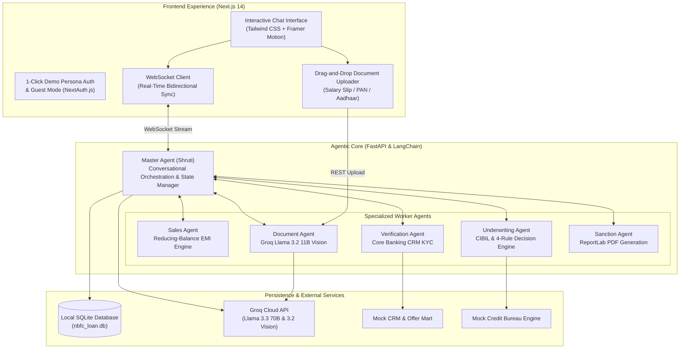
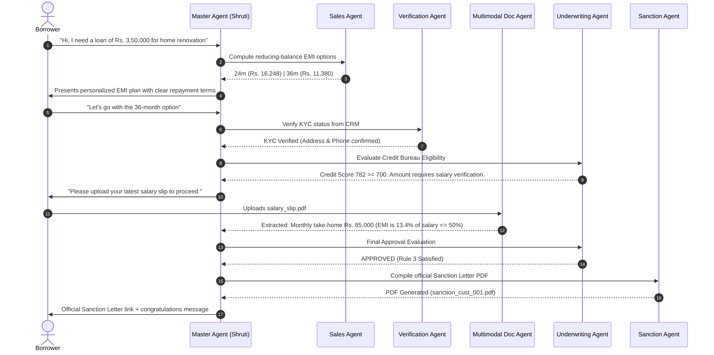

# 🏦 NBFC Agentic Conversational Loan Platform
### *AI-Powered Digital Lending Assistant — Built for EY Techathon 6.0*

[](https://nextjs.org/)
[](https://fastapi.tiangolo.com/)
[](https://groq.com/)
[](https://groq.com/)
[-003B57?logo=sqlite)](https://sqlite.org/)
[](https://opensource.org/licenses/MIT)

---

## 🌟 Executive Summary

The **NBFC Agentic Conversational Loan Platform** is a state-of-the-art digital sales assistant engineered to maximize personal loan conversion for Non-Banking Financial Companies. Built on an advanced **Master-Worker Agentic Architecture**, the platform replaces rigid rule-based chatbots with an empathetic, human-like sales conversationalist named **Shruti**. 

Shruti coordinates specialized Worker AI Agents to handle consultative requirement discovery, transparent EMI pricing, real-time CRM KYC verification, zero-OCR multimodal document extraction, credit underwriting rule enforcement, and instant PDF sanction letter issuance.



---

## 🚀 Key Innovations & Differentiators

| Capability | Legacy Approach | Our Agentic Solution |
| :--- | :--- | :--- |
| **Agent Architecture** | Static decision trees or single monolithic LLM prompt | **Master-Worker Agentic Graph**: Master orchestrates specialized Worker Agents for sales, verification, underwriting, and PDF generation. |
| **Document Processing** | Fragile Tesseract OCR, Poppler binary dependencies, and rigid regexes | **Multimodal Vision AI**: Groq Llama 3.2 11B Vision directly parses PDFs and images to extract salary, PAN, and Aadhaar numbers. |
| **Database Dependency** | External PostgreSQL / Redis setup requiring manual installation | **Zero-Config Local SQLite**: Instant spin-up on any environment (`sqlite:///./nbfc_loan.db`). |
| **Authentication** | External Google OAuth credentials blocking local demo testing | **1-Click Test Persona Selector**: Pre-seeded demo accounts (Rahul, Priya, Vikram, Anjali, etc.) plus Instant Guest Mode. |
| **Underwriting Policy** | Opaque black-box outputs | **Deterministic 4-Rule Decision Matrix**: Instant approval for $\le$ pre-approved, salary check for $\le 2\times$, and transparent rejection handling. |
| **Sanction Issuance** | Static dummy mock text | **Dynamic PDF Generation**: Generates official sanction letters with terms, EMIs, and NBFC digital stamps. |

---

## 🎭 Agent Hierarchy & Responsibilities



---

## 📋 Comprehensive Documentation Index

Explore our in-depth technical specifications and architectural documentation:

- 📄 [docs/PROBLEM_STATEMENT.md](file:///e:/Projects/nbfc-loan-chatbot/docs/PROBLEM_STATEMENT.md) — Official EY Techathon 6.0 context, business goals, and evaluation criteria.
- 📐 [docs/ARCHITECTURE.md](file:///e:/Projects/nbfc-loan-chatbot/docs/ARCHITECTURE.md) — Deep-dive system architecture, agent state machine, data models, and sequence diagrams.
- 🔌 [docs/API_SPECIFICATION.md](file:///e:/Projects/nbfc-loan-chatbot/docs/API_SPECIFICATION.md) — Complete REST endpoint schemas, WebSocket protocols, and JSON payloads.
- ⚖️ [docs/SYSTEM_ASSUMPTIONS_AND_RULES.md](file:///e:/Projects/nbfc-loan-chatbot/docs/SYSTEM_ASSUMPTIONS_AND_RULES.md) — Underwriting policy matrix, financial math formulas, and 10 synthetic customer profiles.

---

## 👥 Demo Personas & Test Scenarios

Navigate to `http://localhost:3000/login` to select any of the pre-configured demo personas:

| Persona | Role / Profile | Testing Objective | Expected Outcome |
| :--- | :--- | :--- | :--- |
| **Rahul Sharma** | Tech Lead, Mumbai<br>Pre-approved: **Rs. 5,00,000**<br>Score: **782** | **Happy Path Fast-Track**: Request Rs. 3,50,000 (within pre-approved limit). | ⚡ **Instant Sanction** without requiring documents. Official PDF generated. |
| **Priya Patel** | Product Manager, Bangalore<br>Pre-approved: **Rs. 7,50,000**<br>Score: **820** | **High-Value Prime Borrower**: Request Rs. 6,00,000. | 🏆 **Instant Sanction** at prime interest rate (10.0% p.a.). |
| **Amit Kumar** | Operations Manager, Delhi<br>Pre-approved: **Rs. 3,00,000**<br>Score: **715** | **Income Enhancement**: Request Rs. 4,50,000 ($> 1\times$ pre-approved). | 📄 Prompts for **Salary Slip**. Validates EMI $\le 50\%$ income and approves. |
| **Vikram Singh** | Consultant, Pune<br>Credit Score: **680** ($< 700$) | **Adverse Action Edge Case**: Low credit score test. | ❌ **Transparent Rejection** explaining the 700 threshold with advisory guidance. |
| **Anjali Verma** | Marketing Specialist, Chennai<br>KYC: **Pending** | **KYC Onboarding**: Missing KYC address and phone. | 🔍 **Verification Agent** walks applicant through KYC confirmation. |
| **Guest User** | Unauthenticated walk-in | **Walk-in Discovery Flow**: New-to-bank applicant. | 👤 Collects PAN/Aadhaar via Vision AI and dynamically creates customer profile. |

---

## 🛠️ Step-by-Step Run Guide

### 1. Prerequisites
- **Node.js**: v18.0.0 or later
- **Python**: v3.10, v3.11, or v3.12
- **Groq API Key**: Free API key from [Groq Console](https://console.groq.com)

---

### 2. Backend Setup

```powershell
# Navigate to the backend directory
cd backend

# Create and activate a Python virtual environment
python -m venv venv

# Windows PowerShell:
.\venv\Scripts\Activate.ps1
# (Or Linux/macOS: source venv/bin/activate)

# Install backend dependencies
pip install -r requirements.txt

# Configure your backend .env file (ensure GROQ_API_KEY is set)
# backend/.env:
# DATABASE_URL=sqlite:///./nbfc_loan.db
# GROQ_API_KEY=gsk_your_groq_api_key_here

# Start the FastAPI server (with 1MB header buffer to prevent HTTP 431)
python run.py
# (Or: uvicorn app.main:app --reload --port 8000 --http h11 --h11-max-incomplete-event-size 1048576)
```
> The backend server will start at `http://localhost:8000`. Fast-track health check: `http://localhost:8000/`.

---

### 3. Frontend Setup

In a new terminal window:

```powershell
# In project root:
cd ..  # If inside backend/

# Install Node modules
npm install

# Start Next.js development server
npm run dev
```
> The frontend application will be live at `http://localhost:3000`.

---

## 🧪 Automated Test Suite (28 Comprehensive Tests)

The platform includes an automated test suite validating all 10 problem statement conversational journeys, 4-tier underwriting decision rules, financial amortization math, and multimodal Vision AI document parsing:

```powershell
cd backend
.\venv\Scripts\Activate.ps1

# Run the unified master test runner:
python run_all_tests.py

# Or via pytest:
pytest tests/ -v
```

| Test Module | Coverage Scope | Status |
| :--- | :--- | :---: |
| **`test_agent_orchestration.py`** | All 10 Problem Statement Scenarios (Rules 1-4, Fast-track instant sanction, FOIR calculation, Single-borrower cap, KYC onboarding, Guest walk-in, Context retention) | **100% Passed (9/9)** |
| **`test_financial_math.py`** | Reducing-balance EMI math, dynamic interest rate tiering (prime 9.5% vs standard 10.5% vs subprime 12.5%), tenure suggestion algorithms | **100% Passed (10/10)** |
| **`test_document_vision.py`** | PyMuPDF page rendering, markdown code-fence parsing resilience, multimodal extraction pipelines for Salary Slips, PAN, and Aadhaar | **100% Passed (9/9)** |

---

## 🧪 Interactive Walkthrough for Evaluators

1. Open your browser and visit [http://localhost:3000](http://localhost:3000).
2. Click **"Explore Demo Personas"** or navigate directly to [http://localhost:3000/login](http://localhost:3000/login).
3. Click on **"Rahul Sharma"** to automatically populate credentials and sign in.
4. The chat interface opens with a personalized welcome from **Shruti**:
   > *"Hello Rahul! Welcome back to NBFC Finance. As a valued customer, you have a pre-approved personal loan of up to **Rs. 5,00,000** ready for immediate disbursal. How can I help you today?"*
5. Try asking:
   - *"I want Rs. 3,50,000 for home renovation. What are the EMI options for 24 and 36 months?"*
   - *"Let's go with 36 months. Please proceed."*
6. Watch the **Underwriting Agent** approve the application and the **Sanction Agent** generate a downloadable PDF sanction letter with digital seal and terms.

---

## 📂 Project Structure

```text
nbfc-loan-chatbot/
├── app/                              # Next.js 14 App Router
│   ├── api/auth/[...nextauth]/       # NextAuth Credentials Auth Handler
│   ├── login/                        # Dedicated Persona Login Page
│   ├── page.tsx                      # Modern Landing Page & Portal
│   └── layout.tsx                    # Root Layout & SessionProvider
├── components/                       # React UI Components
│   ├── ChatWidget.tsx                # WebSocket Chat Interface & Fast Replies
│   └── DocumentUpload.tsx            # Drag-and-drop Document Ingestion
├── backend/                          # FastAPI Backend Application
│   ├── app/
│   │   ├── agents/                   # Agentic AI Architecture
│   │   │   ├── master_agent_llm.py   # Shruti Master Coordinator (Llama 3.3 70B)
│   │   │   ├── sales_agent.py        # Sales Advisor & EMI Math
│   │   │   ├── verification_agent.py # CRM KYC Verification Agent
│   │   │   ├── document_agent.py     # Multimodal Vision AI Document Agent
│   │   │   ├── underwriting_agent.py # Credit Bureau & 4-Rule Decision Engine
│   │   │   ├── sanction_agent.py     # Sanction PDF Generation Agent
│   │   │   ├── state.py              # LangGraph Application State
│   │   │   └── workflow.py           # Multi-Agent Orchestration Graph
│   │   ├── services/                 # Enterprise Mock & Vision Services
│   │   │   ├── ocr_service.py        # Groq Llama 3.2 11B Vision Extractor
│   │   │   ├── credit_bureau.py      # CIBIL / Experian Bureau Simulation
│   │   │   └── pdf_generator.py      # ReportLab PDF Document Engine
│   │   ├── config.py                 # Pydantic Settings & Config
│   │   ├── database.py               # Local SQLite Engine & Session
│   │   ├── main.py                   # FastAPI REST & WebSocket Endpoints
│   │   ├── mock_data.py              # 10 Synthetic Customer Personas & Offer Mart
│   │   └── models.py                 # SQLAlchemy Relational Models
│   ├── tests/                        # Comprehensive Automated Test Suite
│   │   ├── mock_documents.py         # Synthetic Salary Slip, PAN & Aadhaar Generator
│   │   ├── test_agent_orchestration.py # 10 Conversational & Policy Test Scenarios
│   │   ├── test_financial_math.py    # Reducing-Balance EMI & Rate Calculations
│   │   └── test_document_vision.py   # PyMuPDF & Multimodal OCR Resilience
│   ├── run_all_tests.py              # Master Test Runner Script
│   ├── requirements.txt              # Backend Dependencies
│   └── test_llm.py                   # Groq LLM & Vision Diagnostic Test
├── docs/                             # Enterprise Technical Documentation
│   ├── PROBLEM_STATEMENT.md          # EY Techathon 6.0 Objectives
│   ├── ARCHITECTURE.md               # Technical Architecture & Topology
│   ├── API_SPECIFICATION.md          # REST & WebSocket Interface Contract
│   └── SYSTEM_ASSUMPTIONS_AND_RULES.md # Underwriting Policies & Math Models
├── public/                           # Static Assets & Icons
├── README.md                         # Master Documentation
└── package.json                      # Frontend Dependencies
```

---

## ⚖️ License & Acknowledgments

Developed for the **EY Techathon 6.0**. Built with modern agentic AI standards adhering to enterprise banking and NBFC compliance guidelines. Released under the [MIT License](LICENSE).
