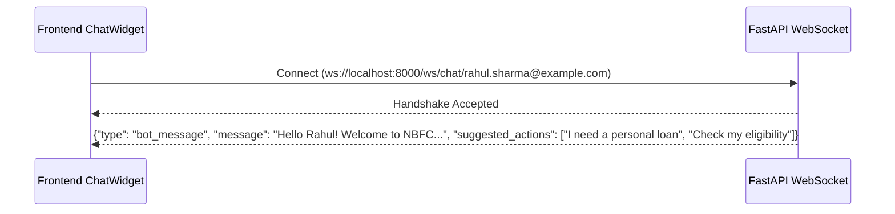

# API Specification — NBFC Agentic Loan Platform

## 1. Overview & Service URLs

The NBFC Loan Platform provides both RESTful endpoints for customer management and document processing, as well as a real-time bidirectional WebSocket interface for the multi-agent conversational engine.

| Protocol | Base URL | Purpose |
| :--- | :--- | :--- |
| **HTTP (REST)** | `http://localhost:8000` | Health checks, customer profiles, document uploads, static files |
| **WebSocket (WS)** | `ws://localhost:8000` | Real-time conversational dialogue with Master & Worker agents |
| **Frontend Web** | `http://localhost:3000` | Next.js 14 Web Portal and interactive chat widget |

---

## 2. REST Endpoints

### 2.1 System Health Check
Check operational readiness of the FastAPI backend.

- **Method**: `GET`
- **Path**: `/`
- **Request Headers**: None
- **Response `200 OK`**:
```json
{
  "status": "healthy",
  "service": "NBFC Loan Chatbot API",
  "version": "1.0.0"
}
```

---

### 2.2 Customer Identification & Creation
Retrieve or create a customer record based on authenticated session or persona details.

- **Method**: `POST`
- **Path**: `/api/customers/`
- **Content-Type**: `application/json`
- **Request Body**:
```json
{
  "google_id": "demo-rahul-sharma",
  "email": "rahul.sharma@example.com",
  "name": "Rahul Sharma",
  "phone": "+91 98765 43210",
  "age": 32,
  "city": "Mumbai",
  "profile_image": null
}
```
- **Response `200 OK`**:
```json
{
  "id": "e4f8c9b2-3d1a-4c8e-b5f7-9a1b2c3d4e5f",
  "google_id": "demo-rahul-sharma",
  "email": "rahul.sharma@example.com",
  "name": "Rahul Sharma",
  "phone": "+91 98765 43210",
  "age": 32,
  "city": "Mumbai",
  "address": "Flat 402, Sea Green Apts, Worli, Mumbai",
  "kyc_verified": true,
  "credit_score": 780,
  "pre_approved_limit": 500000.0,
  "monthly_salary": 95000.0,
  "created_at": "2026-11-19T10:00:00"
}
```

---

### 2.3 Conversation History
Retrieve past conversation sessions for a customer.

- **Method**: `GET`
- **Path**: `/api/customers/{customer_id}/conversations`
- **Path Parameters**:
  - `customer_id` *(string, required)*: Customer UUID or email identifier.
- **Response `200 OK`**:
```json
[
  {
    "id": 1,
    "customer_id": "e4f8c9b2-3d1a-4c8e-b5f7-9a1b2c3d4e5f",
    "started_at": "2026-11-19T14:30:00",
    "ended_at": "2026-11-19T14:45:00",
    "summary": "Customer accepted 36-month loan of Rs. 3,50,000; sanction letter issued."
  }
]
```

---

### 2.4 Document Upload & Multimodal Vision Ingestion
Upload KYC documents (PAN, Aadhaar) or income proof (Salary Slip) for automated Vision AI extraction.

- **Method**: `POST`
- **Path**: `/api/documents/upload`
- **Content-Type**: `multipart/form-data`
- **Form Fields**:
  - `file` *(Binary File, required)*: PDF, JPG, JPEG, or PNG (Max size: 5MB).
  - `document_type` *(string, required)*: One of `salary_slip`, `pan`, `aadhaar`, `bank_statement`.
  - `customer_id` *(string, required)*: Customer ID, email, or `"guest"`.
- **Response `200 OK`**:
```json
{
  "success": true,
  "message": "Salary Slip uploaded successfully! ✅",
  "document_type": "salary_slip",
  "filename": "rahul.sharma@example.com_salary_slip_20261119_153000.pdf",
  "file_path": "uploads/documents/rahul.sharma@example.com_salary_slip_20261119_153000.pdf",
  "uploaded_at": "2026-11-19T15:30:00.123456",
  "extracted_data": {
    "success": true,
    "document_type": "salary_slip",
    "monthly_salary": 95000.0,
    "employer_name": "Tata Consultancy Services",
    "pay_period": "October 2026",
    "confidence": 0.96
  }
}
```

---

### 2.5 List Uploaded Customer Documents
Retrieve metadata for all documents uploaded by a customer.

- **Method**: `GET`
- **Path**: `/api/documents/{customer_id}`
- **Response `200 OK`**:
```json
{
  "customer_id": "rahul.sharma@example.com",
  "count": 1,
  "documents": [
    {
      "filename": "rahul.sharma@example.com_salary_slip_20261119_153000.pdf",
      "document_type": "salary_slip",
      "file_path": "uploads/documents/rahul.sharma@example.com_salary_slip_20261119_153000.pdf"
    }
  ]
}
```

---

### 2.6 Static Sanction Letter Download
Serve dynamically compiled PDF sanction letters and adverse action documents.

- **Method**: `GET`
- **Path**: `/uploads/sanction_letters/{filename}`
- **Response `200 OK`**: Binary PDF stream (`Content-Type: application/pdf`).

---

## 3. WebSocket Real-Time Chat Contract

### 3.1 Connection Handshake
- **URL**: `ws://localhost:8000/ws/chat/{customer_id}`
- **Path Parameter**:
  - `customer_id`: `"guest"` or specific customer email / UUID.

Upon successful connection, the server creates an isolated state session and immediately dispatches an initial greeting:



---

### 3.2 Client-to-Server Payloads

#### Standard User Message
```json
{
  "type": "user_message",
  "message": "I want a loan of Rs. 3,50,000 for 24 months"
}
```

#### Document Upload Notification Event
When a document is uploaded via the REST upload endpoint, the frontend alerts the WebSocket conversation flow using the `__doc_uploaded__` event tag:
```json
{
  "type": "user_message",
  "message": "__doc_uploaded__:salary_slip:rahul.sharma@example.com_salary_slip_20261119_153000.pdf"
}
```

---

### 3.3 Server-to-Client Payloads

#### Conversational Response
```json
{
  "type": "bot_message",
  "message": "Based on a loan of Rs. 3,50,000 for 24 months at 10.5% interest, your monthly EMI will be **Rs. 16,248**.\n\nWould you like to proceed with this plan?",
  "agent": "sales",
  "suggested_actions": [
    "Proceed with 24 months",
    "Show 36 months option",
    "Change amount"
  ]
}
```

#### Sanction Approval Notification
```json
{
  "type": "bot_message",
  "message": "🎉 **Congratulations Rahul! Your loan is officially approved!**\n\n📄 **Sanction Letter Generated:**\n[Download Sanction Letter](http://localhost:8000/uploads/sanction_letters/sanction_CUST001_20261119_153500.pdf)\n\n• **Approved Amount**: Rs. 3,50,000\n• **Tenure**: 36 months\n• **Monthly EMI**: Rs. 11,380\n• **Interest Rate**: 10.50% p.a.\n\nOur disbursement officer will credit your account within 2 hours.",
  "agent": "sanction",
  "suggested_actions": [
    "Apply for another loan",
    "Talk to support"
  ]
}
```

---

## 4. Error Codes & Handling

| HTTP Status | Reason | Client Handling Strategy |
| :--- | :--- | :--- |
| `400 Bad Request` | Unsupported file type or file > 5MB | Display file warning banner; prompt re-upload |
| `404 Not Found` | Customer or document does not exist | Refresh customer profile or re-authenticate |
| `500 Server Error` | OCR or PDF generation failure | Display fallback message: "Underwriting review in progress" |
| `WS Close 1000` | Normal closure | Reconnect on demand |
| `WS Close 1006` | Network drop / Server restart | Automatic reconnect with 1-second exponential backoff |
