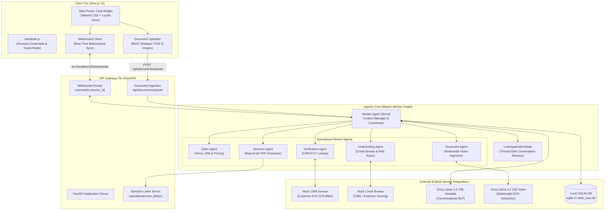
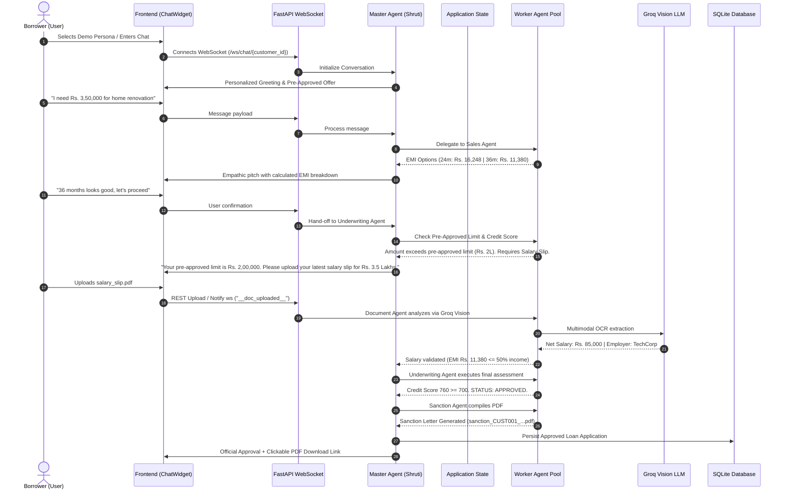
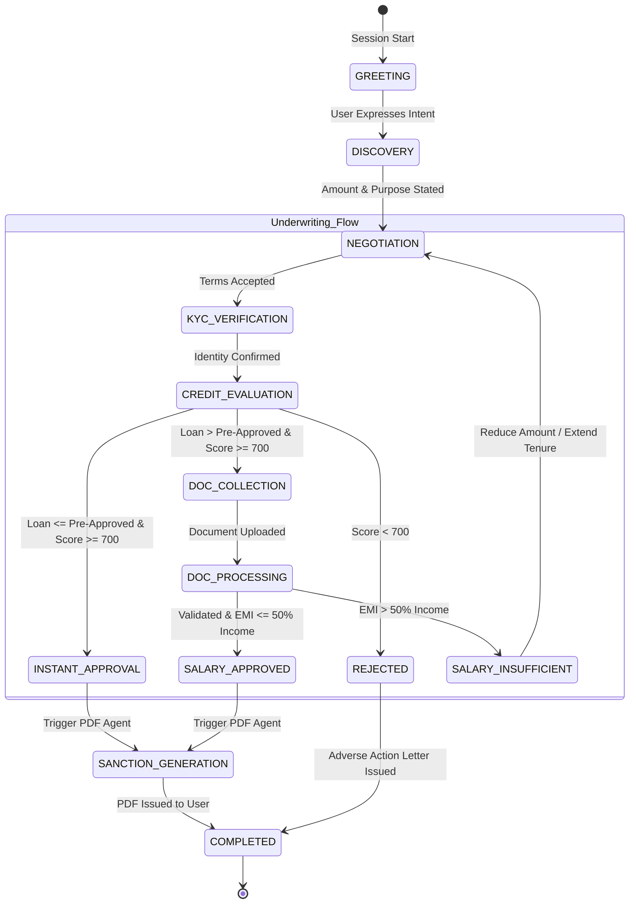
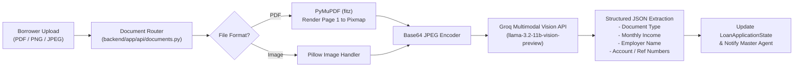
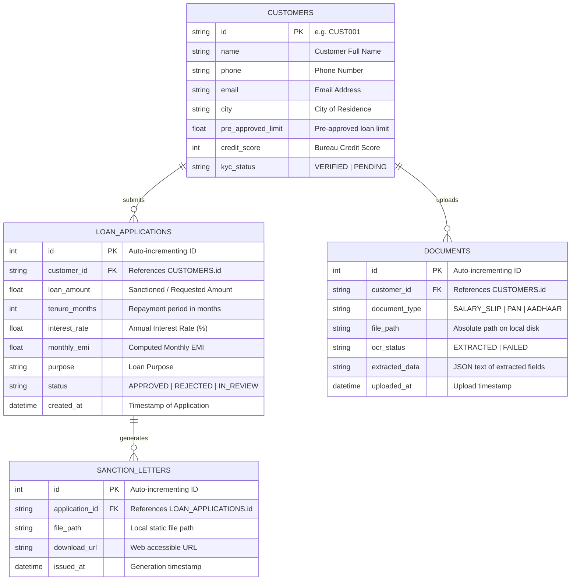

# System Architecture — NBFC Agentic Loan Platform

## 1. System Overview

The **NBFC Agentic Loan Platform** is designed for high-conversion conversational lending. It pairs an asynchronous web frontend with a reactive Python backend powered by a **Master-Worker Agentic AI Graph**, real-time WebSockets, Groq Llama 3.3 70B Language Models, Groq Llama 3.2 Vision LLMs, and a local embedded SQLite database.

---

## 2. Master-Worker Agent Topology

The conversational architecture avoids static script branching by using a **hierarchical coordinator pattern**. The Master Agent acts as the single point of contact for the borrower, maintaining personality, conversational empathy, and memory while dynamically routing domain-specific subtasks to specialized Worker Agents.

| Agent | Role | Capabilities | Trigger Criteria |
| :--- | :--- | :--- | :--- |
| **Master Agent** *(Shruti)* | Orchestrator & Persona | Empathetic dialogue, intent classification, memory management, worker hand-offs | Active on every turn |
| **Sales Agent** | Loan Advisor | Tenures (12-60m), rates (10.5%-18%), reducing-balance EMI calculations | When user discusses amount, tenure, or repayment |
| **Verification Agent** | Identity & KYC | Real-time CRM record verification (phone, address, pre-approved offers) | When borrower confirms identity or selects loan offer |
| **Document Agent** | Multimodal Auditor | Extracts PAN, Aadhaar, and monthly income from uploaded PDFs/images via Groq Vision | Triggered on document upload (`__doc_uploaded__`) |
| **Underwriting Agent** | Risk Assessor | CIBIL credit check, DTI (Debt-To-Income) evaluation, multi-tier risk policy enforcement | When user requests final sanction or accepts offer |
| **Sanction Agent** | Document Issuer | ReportLab PDF compilation, digital stamping, official download link generation | Upon Underwriting approval |

---

## 3. End-to-End Orchestration Sequence

The following sequence diagram outlines the complete multi-turn lifecycle of a loan application, from initial persona greeting to PDF sanction issuance.

---

## 4. Loan Application State Machine

The state transition flow is strictly enforced by the Master-Worker graph to prevent out-of-order execution (e.g. issuing a sanction before KYC or credit approval).

---

## 5. Multimodal Document Extraction Pipeline

The platform leverages Groq's `llama-3.2-11b-vision-preview` model for automated document ingestion without traditional OCR pipeline dependencies (Tesseract or Poppler).

---

## 6. Storage & Database Tier

All persistence operations use a zero-dependency local SQLite database (`sqlite:///./nbfc_loan.db`) managed via SQLAlchemy 2.0 ORM.

---

## 7. Security, Privacy, and Standards

1. **Local Isolation**: Customer data, document uploads, and SQLite database records reside exclusively on the host server; no external database services are required.
2. **Credential Privacy**: API keys (Groq, NextAuth secret) are isolated in `.env` and `.env.local` configurations and never exposed to the client bundle.
3. **Audit Trail**: Every worker delegation, document extraction outcome, and underwriting decision is logged in conversation transcripts and synchronized with database state.
