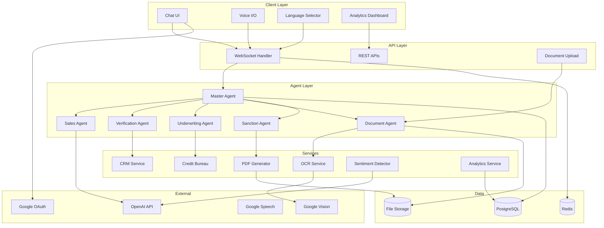

# 🏗️ NBFC Loan Chatbot - System Architecture

## High-Level Architecture Diagram

```
┌─────────────────────────────────────────────────────────────────────────────────────────┐
│                                    CLIENT LAYER                                          │
├─────────────────────────────────────────────────────────────────────────────────────────┤
│                                                                                          │
│  ┌──────────────────────────────────────────────────────────────────────────────────┐   │
│  │                           Next.js 14 Frontend                                     │   │
│  │  ┌─────────────┐  ┌─────────────┐  ┌─────────────┐  ┌─────────────────────────┐  │   │
│  │  │   Chat UI   │  │   Voice     │  │  Language   │  │    Analytics Dashboard  │  │   │
│  │  │  Component  │  │   Input/    │  │  Selector   │  │    (Conversion Funnel)  │  │   │
│  │  │             │  │   Output    │  │  (EN/HI)    │  │                         │  │   │
│  │  └──────┬──────┘  └──────┬──────┘  └──────┬──────┘  └───────────┬─────────────┘  │   │
│  │         │                │                │                     │                │   │
│  │         └────────────────┴────────────────┴─────────────────────┘                │   │
│  │                                    │                                              │   │
│  │  ┌─────────────────────────────────┴─────────────────────────────────────────┐   │   │
│  │  │                        WebSocket Connection                                │   │   │
│  │  │                    (Real-time Bidirectional Chat)                         │   │   │
│  │  └─────────────────────────────────┬─────────────────────────────────────────┘   │   │
│  │                                    │                                              │   │
│  │  ┌─────────────────────────────────┴─────────────────────────────────────────┐   │   │
│  │  │  NextAuth.js (Google OAuth 2.0)  │  Web Speech API (TTS/STT)              │   │   │
│  │  └───────────────────────────────────────────────────────────────────────────┘   │   │
│  └──────────────────────────────────────────────────────────────────────────────────┘   │
│                                                                                          │
└─────────────────────────────────────────────────────────────────────────────────────────┘
                                           │
                                           │ HTTPS / WSS
                                           ▼
┌─────────────────────────────────────────────────────────────────────────────────────────┐
│                                    API GATEWAY LAYER                                     │
├─────────────────────────────────────────────────────────────────────────────────────────┤
│                                                                                          │
│  ┌──────────────────────────────────────────────────────────────────────────────────┐   │
│  │                              FastAPI Application                                  │   │
│  │                                                                                   │   │
│  │  ┌─────────────┐  ┌─────────────┐  ┌─────────────┐  ┌─────────────────────────┐  │   │
│  │  │  WebSocket  │  │    REST     │  │  Document   │  │      Analytics          │  │   │
│  │  │   /ws/chat  │  │    APIs     │  │   Upload    │  │       APIs              │  │   │
│  │  │             │  │             │  │    API      │  │                         │  │   │
│  │  └──────┬──────┘  └──────┬──────┘  └──────┬──────┘  └───────────┬─────────────┘  │   │
│  │         │                │                │                     │                │   │
│  │  ┌──────┴────────────────┴────────────────┴─────────────────────┴────────────┐   │   │
│  │  │                         CORS Middleware                                    │   │   │
│  │  │                    Pydantic Validation Layer                              │   │   │
│  │  └───────────────────────────────────────────────────────────────────────────┘   │   │
│  └──────────────────────────────────────────────────────────────────────────────────┘   │
│                                                                                          │
└─────────────────────────────────────────────────────────────────────────────────────────┘
                                           │
                                           ▼
┌─────────────────────────────────────────────────────────────────────────────────────────┐
│                              MULTI-AGENT ORCHESTRATION LAYER                             │
├─────────────────────────────────────────────────────────────────────────────────────────┤
│                                                                                          │
│  ┌──────────────────────────────────────────────────────────────────────────────────┐   │
│  │                            LangGraph Workflow Engine                              │   │
│  │                                                                                   │   │
│  │                         ┌─────────────────────────┐                              │   │
│  │                         │      MASTER AGENT       │                              │   │
│  │                         │  ┌─────────────────┐    │                              │   │
│  │                         │  │ Intent Analysis │    │                              │   │
│  │                         │  │ Language Detect │    │                              │   │
│  │                         │  │ Sentiment Score │    │                              │   │
│  │                         │  │ Agent Routing   │    │                              │   │
│  │                         │  └─────────────────┘    │                              │   │
│  │                         └───────────┬─────────────┘                              │   │
│  │                                     │                                             │   │
│  │           ┌─────────────────────────┼─────────────────────────┐                  │   │
│  │           │                         │                         │                  │   │
│  │           ▼                         ▼                         ▼                  │   │
│  │  ┌─────────────────┐    ┌─────────────────┐    ┌─────────────────┐              │   │
│  │  │   SALES AGENT   │    │VERIFICATION AGT │    │UNDERWRITING AGT │              │   │
│  │  │ ┌─────────────┐ │    │ ┌─────────────┐ │    │ ┌─────────────┐ │              │   │
│  │  │ │ A/B Testing │ │    │ │ KYC Check   │ │    │ │ Credit Score│ │              │   │
│  │  │ │ EMI Calc    │ │    │ │ CRM Lookup  │ │    │ │ Risk Assess │ │              │   │
│  │  │ │ Loan Offers │ │    │ │ Doc Verify  │ │    │ │ Explainable │ │              │   │
│  │  │ │ Conversion  │ │    │ │             │ │    │ │ Decisions   │ │              │   │
│  │  │ └─────────────┘ │    │ └─────────────┘ │    │ └─────────────┘ │              │   │
│  │  └────────┬────────┘    └────────┬────────┘    └────────┬────────┘              │   │
│  │           │                      │                      │                        │   │
│  │           └──────────────────────┼──────────────────────┘                        │   │
│  │                                  ▼                                                │   │
│  │           ┌─────────────────────────────────────────────┐                        │   │
│  │           │                                             │                        │   │
│  │           ▼                                             ▼                        │   │
│  │  ┌─────────────────┐                         ┌─────────────────┐                 │   │
│  │  │ DOCUMENT AGENT  │                         │  SANCTION AGENT │                 │   │
│  │  │ ┌─────────────┐ │                         │ ┌─────────────┐ │                 │   │
│  │  │ │ OCR Process │ │                         │ │ PDF Generate│ │                 │   │
│  │  │ │ Doc Request │ │                         │ │ Letter Gen  │ │                 │   │
│  │  │ │ Validation  │ │                         │ │ Multilingual│ │                 │   │
│  │  │ └─────────────┘ │                         │ └─────────────┘ │                 │   │
│  │  └─────────────────┘                         └─────────────────┘                 │   │
│  │                                                                                   │   │
│  │  ┌───────────────────────────────────────────────────────────────────────────┐   │   │
│  │  │                      Shared State (LoanApplicationState)                   │   │   │
│  │  │  customer_info │ loan_details │ credit_data │ documents │ conversation    │   │   │
│  │  └───────────────────────────────────────────────────────────────────────────┘   │   │
│  └──────────────────────────────────────────────────────────────────────────────────┘   │
│                                                                                          │
└─────────────────────────────────────────────────────────────────────────────────────────┘
                                           │
                                           ▼
┌─────────────────────────────────────────────────────────────────────────────────────────┐
│                                    SERVICES LAYER                                        │
├─────────────────────────────────────────────────────────────────────────────────────────┤
│                                                                                          │
│  ┌────────────────┐  ┌────────────────┐  ┌────────────────┐  ┌────────────────────────┐ │
│  │   OCR Service  │  │ Credit Bureau  │  │  CRM Service   │  │   PDF Generator        │ │
│  │ ┌────────────┐ │  │ ┌────────────┐ │  │ ┌────────────┐ │  │ ┌────────────────────┐ │ │
│  │ │ Tesseract  │ │  │ │ Score Fetch│ │  │ │ Customer   │ │  │ │ ReportLab          │ │ │
│  │ │ Google     │ │  │ │ Rating     │ │  │ │ Lookup     │ │  │ │ Sanction Letters   │ │ │
│  │ │ Vision API │ │  │ │ History    │ │  │ │ Profile    │ │  │ │ Multilingual       │ │ │
│  │ └────────────┘ │  │ └────────────┘ │  │ └────────────┘ │  │ └────────────────────┘ │ │
│  └────────────────┘  └────────────────┘  └────────────────┘  └────────────────────────┘ │
│                                                                                          │
│  ┌────────────────┐  ┌────────────────┐  ┌────────────────┐  ┌────────────────────────┐ │
│  │Sentiment Svc   │  │  Voice Service │  │Analytics Svc   │  │   LLM Factory          │ │
│  │ ┌────────────┐ │  │ ┌────────────┐ │  │ ┌────────────┐ │  │ ┌────────────────────┐ │ │
│  │ │ LLM-based  │ │  │ │ TTS/STT    │ │  │ │ Funnel     │ │  │ │ OpenAI GPT-3.5/4   │ │ │
│  │ │ Emotion    │ │  │ │ Google     │ │  │ │ A/B Test   │ │  │ │ Groq (Llama)       │ │ │
│  │ │ Detection  │ │  │ │ Cloud APIs │ │  │ │ Conversion │ │  │ │ Temperature Config │ │ │
│  │ └────────────┘ │  │ └────────────┘ │  │ └────────────┘ │  │ └────────────────────┘ │ │
│  └────────────────┘  └────────────────┘  └────────────────┘  └────────────────────────┘ │
│                                                                                          │
└─────────────────────────────────────────────────────────────────────────────────────────┘
                                           │
                                           ▼
┌─────────────────────────────────────────────────────────────────────────────────────────┐
│                                    DATA LAYER                                            │
├─────────────────────────────────────────────────────────────────────────────────────────┤
│                                                                                          │
│  ┌──────────────────────────────┐  ┌──────────────────────────────┐                     │
│  │        PostgreSQL            │  │           Redis              │                     │
│  │  ┌────────────────────────┐  │  │  ┌────────────────────────┐  │                     │
│  │  │ customers              │  │  │  │ Session Cache          │  │                     │
│  │  │ conversations          │  │  │  │ Rate Limiting          │  │                     │
│  │  │ messages               │  │  │  │ A/B Test Assignments   │  │                     │
│  │  │ loan_applications      │  │  │  └────────────────────────┘  │                     │
│  │  │ analytics_events       │  │  │                              │                     │
│  │  └────────────────────────┘  │  │                              │                     │
│  │                              │  │                              │                     │
│  │  SQLAlchemy ORM              │  │                              │                     │
│  └──────────────────────────────┘  └──────────────────────────────┘                     │
│                                                                                          │
│  ┌──────────────────────────────┐                                                       │
│  │       File Storage           │                                                       │
│  │  ┌────────────────────────┐  │                                                       │
│  │  │ uploads/documents/     │  │  (Aadhaar, PAN, Salary Slips)                        │
│  │  │ uploads/sanction_letters│ │  (Generated PDFs)                                    │
│  │  └────────────────────────┘  │                                                       │
│  └──────────────────────────────┘                                                       │
│                                                                                          │
└─────────────────────────────────────────────────────────────────────────────────────────┘
                                           │
                                           ▼
┌─────────────────────────────────────────────────────────────────────────────────────────┐
│                               EXTERNAL SERVICES LAYER                                    │
├─────────────────────────────────────────────────────────────────────────────────────────┤
│                                                                                          │
│  ┌────────────────┐  ┌────────────────┐  ┌────────────────┐  ┌────────────────────────┐ │
│  │   OpenAI API   │  │ Google Cloud   │  │ Google Cloud   │  │   Google OAuth 2.0     │ │
│  │                │  │ Vision API     │  │ Speech APIs    │  │                        │ │
│  │  GPT-3.5/4     │  │                │  │                │  │  Authentication        │ │
│  │  Embeddings    │  │  OCR           │  │  TTS / STT     │  │  User Identity         │ │
│  └────────────────┘  └────────────────┘  └────────────────┘  └────────────────────────┘ │
│                                                                                          │
└─────────────────────────────────────────────────────────────────────────────────────────┘
```

---

## Component Interaction Diagram



---

## Data Flow Architecture

```
┌─────────────────────────────────────────────────────────────────────────────┐
│                              DATA FLOW                                       │
└─────────────────────────────────────────────────────────────────────────────┘

USER INPUT                    PROCESSING                         OUTPUT
─────────────────────────────────────────────────────────────────────────────

┌─────────┐     ┌──────────┐     ┌──────────┐     ┌──────────┐     ┌─────────┐
│  Text   │────▶│ Language │────▶│ Sentiment│────▶│  Intent  │────▶│  Agent  │
│  Input  │     │ Detection│     │ Analysis │     │ Classify │     │ Routing │
└─────────┘     └──────────┘     └──────────┘     └──────────┘     └────┬────┘
                                                                        │
┌─────────┐     ┌──────────┐                                           │
│  Voice  │────▶│   STT    │───────────────────────────────────────────┘
│  Input  │     │ (Speech  │
└─────────┘     │ to Text) │
                └──────────┘

                                      │
                                      ▼
                    ┌─────────────────────────────────────┐
                    │         AGENT PROCESSING            │
                    │                                     │
                    │  ┌─────────┐  ┌─────────────────┐  │
                    │  │  State  │◀▶│  LLM Inference  │  │
                    │  │ Update  │  │  (GPT-3.5/4)    │  │
                    │  └─────────┘  └─────────────────┘  │
                    │                                     │
                    │  ┌─────────┐  ┌─────────────────┐  │
                    │  │ Service │◀▶│  External APIs  │  │
                    │  │  Calls  │  │  (OCR/Credit)   │  │
                    │  └─────────┘  └─────────────────┘  │
                    └─────────────────────────────────────┘
                                      │
                                      ▼
┌─────────┐     ┌──────────┐     ┌──────────┐     ┌──────────┐     ┌─────────┐
│  Text   │◀────│ Language │◀────│ Response │◀────│ Template │◀────│ Agent   │
│ Output  │     │ Localize │     │ Generate │     │ Select   │     │ Output  │
└─────────┘     └──────────┘     └──────────┘     └──────────┘     └─────────┘
                     │
                     ▼
┌─────────┐     ┌──────────┐
│  Voice  │◀────│   TTS    │
│ Output  │     │ (Text to │
└─────────┘     │  Speech) │
                └──────────┘
```

---

## Technology Stack Diagram

```
┌─────────────────────────────────────────────────────────────────────────────┐
│                           TECHNOLOGY STACK                                   │
└─────────────────────────────────────────────────────────────────────────────┘

┌─────────────────────────────────────────────────────────────────────────────┐
│ FRONTEND                                                                     │
│ ┌───────────┐ ┌───────────┐ ┌───────────┐ ┌───────────┐ ┌───────────────┐   │
│ │ Next.js   │ │TypeScript │ │ Tailwind  │ │  Framer   │ │  NextAuth.js  │   │
│ │   14      │ │           │ │   CSS     │ │  Motion   │ │ (Google OAuth)│   │
│ └───────────┘ └───────────┘ └───────────┘ └───────────┘ └───────────────┘   │
│ ┌───────────┐ ┌───────────┐ ┌───────────────────────────────────────────┐   │
│ │  Lucide   │ │Web Speech │ │              WebSocket Client             │   │
│ │  Icons    │ │   API     │ │                                           │   │
│ └───────────┘ └───────────┘ └───────────────────────────────────────────┘   │
└─────────────────────────────────────────────────────────────────────────────┘

┌─────────────────────────────────────────────────────────────────────────────┐
│ BACKEND                                                                      │
│ ┌───────────┐ ┌───────────┐ ┌───────────┐ ┌───────────┐ ┌───────────────┐   │
│ │  FastAPI  │ │ LangGraph │ │ LangChain │ │SQLAlchemy │ │   Pydantic    │   │
│ │  0.104    │ │   0.2     │ │   0.2     │ │   2.0     │ │     2.7       │   │
│ └───────────┘ └───────────┘ └───────────┘ └───────────┘ └───────────────┘   │
│ ┌───────────┐ ┌───────────┐ ┌───────────┐ ┌───────────────────────────────┐ │
│ │  Uvicorn  │ │WebSockets │ │ ReportLab │ │         pytesseract           │ │
│ │           │ │           │ │   (PDF)   │ │           (OCR)               │ │
│ └───────────┘ └───────────┘ └───────────┘ └───────────────────────────────┘ │
└─────────────────────────────────────────────────────────────────────────────┘

┌─────────────────────────────────────────────────────────────────────────────┐
│ AI/ML                                                                        │
│ ┌───────────────────┐ ┌───────────────────┐ ┌───────────────────────────┐   │
│ │   OpenAI API      │ │  Google Cloud     │ │    Google Cloud           │   │
│ │   GPT-3.5 / 4     │ │  Vision API       │ │    Speech-to-Text         │   │
│ │   (Conversation)  │ │  (OCR)            │ │    Text-to-Speech         │   │
│ └───────────────────┘ └───────────────────┘ └───────────────────────────┘   │
│ ┌───────────────────┐ ┌───────────────────────────────────────────────────┐ │
│ │   Groq API        │ │              Tesseract OCR (Offline)              │ │
│ │   (Llama 3.1)     │ │                                                   │ │
│ └───────────────────┘ └───────────────────────────────────────────────────┘ │
└─────────────────────────────────────────────────────────────────────────────┘

┌─────────────────────────────────────────────────────────────────────────────┐
│ DATA STORAGE                                                                 │
│ ┌───────────────────────────┐ ┌───────────────────────────────────────────┐ │
│ │      PostgreSQL 14        │ │                Redis                      │ │
│ │   (Primary Database)      │ │         (Cache & Sessions)                │ │
│ └───────────────────────────┘ └───────────────────────────────────────────┘ │
└─────────────────────────────────────────────────────────────────────────────┘
```

---

## Security Architecture

```
┌─────────────────────────────────────────────────────────────────────────────┐
│                          SECURITY LAYERS                                     │
└─────────────────────────────────────────────────────────────────────────────┘

┌─────────────────────────────────────────────────────────────────────────────┐
│ AUTHENTICATION & AUTHORIZATION                                               │
│ ┌─────────────────────────────────────────────────────────────────────────┐ │
│ │                        Google OAuth 2.0                                  │ │
│ │  ┌─────────────┐  ┌─────────────┐  ┌─────────────┐  ┌─────────────────┐ │ │
│ │  │   Login     │  │   Token     │  │   Session   │  │   Per-User      │ │ │
│ │  │   Flow      │──▶│ Validation │──▶│   Create    │──▶│   Isolation    │ │ │
│ │  └─────────────┘  └─────────────┘  └─────────────┘  └─────────────────┘ │ │
│ └─────────────────────────────────────────────────────────────────────────┘ │
└─────────────────────────────────────────────────────────────────────────────┘

┌─────────────────────────────────────────────────────────────────────────────┐
│ API SECURITY                                                                 │
│ ┌───────────────┐  ┌───────────────┐  ┌───────────────┐  ┌───────────────┐ │
│ │     CORS      │  │    Rate       │  │    Input      │  │   SQL         │ │
│ │   Whitelist   │  │   Limiting    │  │  Validation   │  │  Injection    │ │
│ │               │  │   (Redis)     │  │  (Pydantic)   │  │  Prevention   │ │
│ └───────────────┘  └───────────────┘  └───────────────┘  └───────────────┘ │
└─────────────────────────────────────────────────────────────────────────────┘

┌─────────────────────────────────────────────────────────────────────────────┐
│ DATA SECURITY                                                                │
│ ┌───────────────┐  ┌───────────────┐  ┌───────────────┐  ┌───────────────┐ │
│ │  Environment  │  │   Document    │  │     PII       │  │   Secure      │ │
│ │   Variables   │  │  Encryption   │  │   Masking     │  │   Storage     │ │
│ │   (.env)      │  │   at Rest     │  │   in Logs     │  │   (uploads/)  │ │
│ └───────────────┘  └───────────────┘  └───────────────┘  └───────────────┘ │
└─────────────────────────────────────────────────────────────────────────────┘
```
