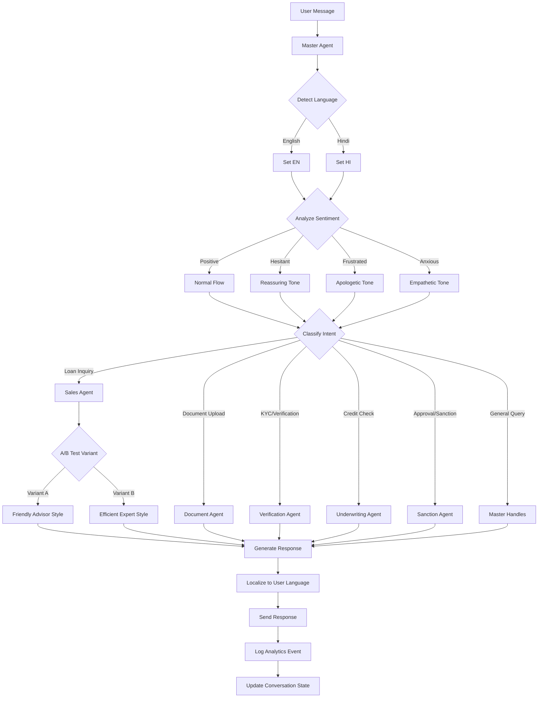
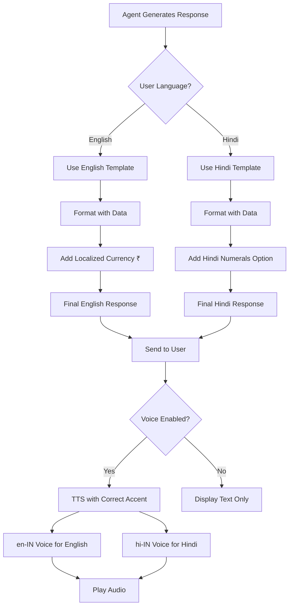

# 📊 NBFC Loan Chatbot - Process Flowcharts

## 1. Complete Loan Application Flow

```
┌─────────────────────────────────────────────────────────────────────────────────────────┐
│                         COMPLETE LOAN APPLICATION FLOWCHART                              │
└─────────────────────────────────────────────────────────────────────────────────────────┘

                                    ┌─────────────┐
                                    │    START    │
                                    └──────┬──────┘
                                           │
                                           ▼
                              ┌────────────────────────┐
                              │   User Opens Chatbot   │
                              │   (Web / Voice)        │
                              └────────────┬───────────┘
                                           │
                                           ▼
                              ┌────────────────────────┐
                              │   Language Detection   │
                              │   (English / Hindi)    │
                              └────────────┬───────────┘
                                           │
                                           ▼
                    ┌──────────────────────────────────────────────┐
                    │              User Authenticated?              │
                    └──────────────────────┬───────────────────────┘
                                           │
                         ┌─────────────────┴─────────────────┐
                         │                                   │
                         ▼                                   ▼
              ┌──────────────────┐                ┌──────────────────┐
              │   Google OAuth   │                │   Guest Mode     │
              │   Login Flow     │                │   (Limited)      │
              └────────┬─────────┘                └────────┬─────────┘
                       │                                   │
                       └─────────────────┬─────────────────┘
                                         │
                                         ▼
                              ┌────────────────────────┐
                              │   Shruti Welcomes      │
                              │   User (Personalized)  │
                              └────────────┬───────────┘
                                           │
                                           ▼
                              ┌────────────────────────┐
                              │   Master Agent         │
                              │   Analyzes Intent      │
                              └────────────┬───────────┘
                                           │
                                           ▼
                    ┌──────────────────────────────────────────────┐
                    │              Sentiment Analysis               │
                    │   (Positive / Neutral / Hesitant / Anxious)  │
                    └──────────────────────┬───────────────────────┘
                                           │
                                           ▼
                    ┌──────────────────────────────────────────────┐
                    │                User Intent?                   │
                    └──────────────────────┬───────────────────────┘
                                           │
              ┌────────────────────────────┼────────────────────────────┐
              │                            │                            │
              ▼                            ▼                            ▼
    ┌─────────────────┐         ┌─────────────────┐         ┌─────────────────┐
    │  Loan Inquiry   │         │  Check Status   │         │  General Query  │
    │                 │         │                 │         │                 │
    └────────┬────────┘         └────────┬────────┘         └────────┬────────┘
             │                           │                           │
             ▼                           │                           │
    ┌─────────────────┐                  │                           │
    │  Route to       │                  │                           │
    │  SALES AGENT    │                  │                           │
    └────────┬────────┘                  │                           │
             │                           │                           │
             ▼                           │                           │
    ┌─────────────────┐                  │                           │
    │  A/B Test       │                  │                           │
    │  Variant Select │                  │                           │
    │  (A or B)       │                  │                           │
    └────────┬────────┘                  │                           │
             │                           │                           │
             ▼                           │                           │
    ┌─────────────────┐                  │                           │
    │  Collect Loan   │                  │                           │
    │  Requirements   │                  │                           │
    │  - Amount       │                  │                           │
    │  - Tenure       │                  │                           │
    │  - Purpose      │                  │                           │
    └────────┬────────┘                  │                           │
             │                           │                           │
             ▼                           │                           │
    ┌─────────────────┐                  │                           │
    │  Calculate EMI  │                  │                           │
    │  Present Offer  │                  │                           │
    └────────┬────────┘                  │                           │
             │                           │                           │
             ▼                           │                           │
    ┌─────────────────────────┐          │                           │
    │  Amount ≤ Pre-approved? │          │                           │
    └────────────┬────────────┘          │                           │
                 │                       │                           │
       ┌─────────┴─────────┐             │                           │
       │                   │             │                           │
       ▼                   ▼             │                           │
┌────────────┐      ┌────────────┐       │                           │
│    YES     │      │     NO     │       │                           │
│  Instant   │      │  Docs Req  │       │                           │
│  Approval  │      │            │       │                           │
│   Path     │      │            │       │                           │
└─────┬──────┘      └─────┬──────┘       │                           │
      │                   │              │                           │
      │                   ▼              │                           │
      │         ┌─────────────────┐      │                           │
      │         │  DOCUMENT AGENT │      │                           │
      │         │  Request Docs   │      │                           │
      │         │  - Salary Slip  │      │                           │
      │         │  - Bank Stmt    │      │                           │
      │         └────────┬────────┘      │                           │
      │                  │               │                           │
      │                  ▼               │                           │
      │         ┌─────────────────┐      │                           │
      │         │  User Uploads   │      │                           │
      │         │  Document       │      │                           │
      │         └────────┬────────┘      │                           │
      │                  │               │                           │
      │                  ▼               │                           │
      │         ┌─────────────────┐      │                           │
      │         │  OCR Processing │      │                           │
      │         │  (Tesseract/    │      │                           │
      │         │   Vision API)   │      │                           │
      │         └────────┬────────┘      │                           │
      │                  │               │                           │
      │                  ▼               │                           │
      │         ┌─────────────────┐      │                           │
      │         │  Extract Data   │      │                           │
      │         │  - Salary       │      │                           │
      │         │  - Employer     │      │                           │
      │         └────────┬────────┘      │                           │
      │                  │               │                           │
      └──────────────────┼───────────────┘                           │
                         │                                           │
                         ▼                                           │
              ┌────────────────────────┐                             │
              │   VERIFICATION AGENT   │                             │
              │   - KYC Check          │                             │
              │   - CRM Lookup         │                             │
              │   - PAN Validation     │                             │
              └────────────┬───────────┘                             │
                           │                                         │
                           ▼                                         │
              ┌────────────────────────┐                             │
              │   UNDERWRITING AGENT   │                             │
              │   - Credit Score Fetch │                             │
              │   - Risk Assessment    │                             │
              │   - EMI/Income Ratio   │                             │
              └────────────┬───────────┘                             │
                           │                                         │
                           ▼                                         │
              ┌────────────────────────────────────┐                 │
              │   Generate Explainable Decision    │                 │
              │   - Decision Factors               │                 │
              │   - Confidence Score               │                 │
              │   - Reasoning                      │                 │
              └────────────────┬───────────────────┘                 │
                               │                                     │
                               ▼                                     │
              ┌────────────────────────────────────┐                 │
              │            DECISION                │                 │
              └────────────────┬───────────────────┘                 │
                               │                                     │
         ┌─────────────────────┼─────────────────────┐               │
         │                     │                     │               │
         ▼                     ▼                     ▼               │
┌─────────────────┐  ┌─────────────────┐  ┌─────────────────┐       │
│    APPROVED     │  │  NEEDS MORE     │  │    REJECTED     │       │
│                 │  │    DOCS         │  │                 │       │
└────────┬────────┘  └────────┬────────┘  └────────┬────────┘       │
         │                    │                    │                 │
         │                    │                    ▼                 │
         │                    │         ┌─────────────────┐          │
         │                    │         │  Explain Why    │          │
         │                    │         │  + Offer        │          │
         │                    │         │  Alternative    │          │
         │                    │         └────────┬────────┘          │
         │                    │                  │                   │
         │                    │                  ▼                   │
         │                    │         ┌─────────────────┐          │
         │                    │         │  User Accepts   │          │
         │                    │         │  Alternative?   │          │
         │                    │         └────────┬────────┘          │
         │                    │                  │                   │
         │                    │         ┌────────┴────────┐          │
         │                    │         │                 │          │
         │                    │         ▼                 ▼          │
         │                    │  ┌───────────┐    ┌───────────┐      │
         │                    │  │    YES    │    │    NO     │      │
         │                    │  └─────┬─────┘    └─────┬─────┘      │
         │                    │        │                │            │
         │                    │        │                ▼            │
         │                    │        │        ┌───────────┐        │
         │                    │        │        │   END     │        │
         │                    │        │        │ (Goodbye) │        │
         │                    │        │        └───────────┘        │
         │                    │        │                             │
         │                    ▼        │                             │
         │           ┌────────────────────┐                          │
         │           │  Loop: Request     │                          │
         │           │  Additional Docs   │                          │
         │           └─────────┬──────────┘                          │
         │                     │                                     │
         └─────────────────────┼─────────────────────────────────────┘
                               │
                               ▼
                    ┌────────────────────────┐
                    │    SANCTION AGENT      │
                    │    - Generate PDF      │
                    │    - Multilingual      │
                    │    - Terms & Conditions│
                    └────────────┬───────────┘
                                 │
                                 ▼
                    ┌────────────────────────┐
                    │   Send Sanction Letter │
                    │   (Download Link)      │
                    └────────────┬───────────┘
                                 │
                                 ▼
                    ┌────────────────────────┐
                    │   Track Conversion     │
                    │   (Analytics Service)  │
                    └────────────┬───────────┘
                                 │
                                 ▼
                    ┌────────────────────────┐
                    │   Congratulate User    │
                    │   Next Steps Info      │
                    └────────────┬───────────┘
                                 │
                                 ▼
                           ┌─────────┐
                           │   END   │
                           └─────────┘
```

---

## 2. Multi-Agent Routing Flowchart



---

## 3. OCR Document Processing Flow

```
┌─────────────────────────────────────────────────────────────────────────────┐
│                        OCR DOCUMENT PROCESSING FLOW                          │
└─────────────────────────────────────────────────────────────────────────────┘

                              ┌─────────────────┐
                              │  User Uploads   │
                              │  Document       │
                              └────────┬────────┘
                                       │
                                       ▼
                              ┌─────────────────┐
                              │  Validate File  │
                              │  - Extension    │
                              │  - Size < 5MB   │
                              └────────┬────────┘
                                       │
                         ┌─────────────┴─────────────┐
                         │                           │
                         ▼                           ▼
                  ┌────────────┐              ┌────────────┐
                  │   Valid    │              │  Invalid   │
                  └─────┬──────┘              └─────┬──────┘
                        │                          │
                        │                          ▼
                        │                   ┌────────────┐
                        │                   │ Return     │
                        │                   │ Error Msg  │
                        │                   └────────────┘
                        │
                        ▼
              ┌─────────────────────┐
              │  Identify Doc Type  │
              │  - Aadhaar          │
              │  - PAN              │
              │  - Salary Slip      │
              │  - Bank Statement   │
              └──────────┬──────────┘
                         │
                         ▼
              ┌─────────────────────┐
              │  Select OCR Engine  │
              └──────────┬──────────┘
                         │
           ┌─────────────┴─────────────┐
           │                           │
           ▼                           ▼
┌─────────────────────┐     ┌─────────────────────┐
│  Google Cloud       │     │     Tesseract       │
│  Vision API         │     │     (Fallback)      │
│  (Preferred)        │     │                     │
└──────────┬──────────┘     └──────────┬──────────┘
           │                           │
           └─────────────┬─────────────┘
                         │
                         ▼
              ┌─────────────────────┐
              │  Pre-processing     │
              │  - Deskew           │
              │  - Denoise          │
              │  - Contrast Enhance │
              └──────────┬──────────┘
                         │
                         ▼
              ┌─────────────────────┐
              │  Extract Raw Text   │
              └──────────┬──────────┘
                         │
                         ▼
              ┌─────────────────────┐
              │  Apply Regex        │
              │  Patterns for       │
              │  Field Extraction   │
              └──────────┬──────────┘
                         │
                         ▼
        ┌────────────────┴────────────────┐
        │                                 │
        ▼                                 ▼
┌───────────────┐                ┌───────────────┐
│  Salary Slip  │                │  Aadhaar/PAN  │
│  ─────────────│                │  ─────────────│
│  • Net Salary │                │  • ID Number  │
│  • Gross      │                │  • Name       │
│  • Employer   │                │  • DOB        │
│  • Employee   │                │  • Address    │
└───────┬───────┘                └───────┬───────┘
        │                                │
        └────────────────┬───────────────┘
                         │
                         ▼
              ┌─────────────────────┐
              │  Validate Extracted │
              │  Data               │
              │  - Format Check     │
              │  - Range Check      │
              └──────────┬──────────┘
                         │
                         ▼
              ┌─────────────────────┐
              │  Calculate          │
              │  Confidence Score   │
              └──────────┬──────────┘
                         │
                         ▼
              ┌─────────────────────┐
              │  Update Customer    │
              │  Profile in DB      │
              └──────────┬──────────┘
                         │
                         ▼
              ┌─────────────────────┐
              │  Return Extracted   │
              │  Data to Agent      │
              └─────────────────────┘
```

---

## 4. Underwriting Decision Flow (Explainable AI)

```
┌─────────────────────────────────────────────────────────────────────────────┐
│                    UNDERWRITING DECISION FLOW (XAI)                          │
└─────────────────────────────────────────────────────────────────────────────┘

                              ┌─────────────────┐
                              │  Receive Loan   │
                              │  Application    │
                              └────────┬────────┘
                                       │
                                       ▼
                    ┌──────────────────────────────────┐
                    │        GATHER DECISION FACTORS   │
                    └──────────────────┬───────────────┘
                                       │
         ┌─────────────────────────────┼─────────────────────────────┐
         │                             │                             │
         ▼                             ▼                             ▼
┌─────────────────┐         ┌─────────────────┐         ┌─────────────────┐
│  Credit Score   │         │  Income Data    │         │  Loan Details   │
│  ─────────────  │         │  ─────────────  │         │  ─────────────  │
│  Fetch from     │         │  From Salary    │         │  Amount         │
│  Credit Bureau  │         │  Slip OCR       │         │  Tenure         │
│  via PAN        │         │                 │         │  Purpose        │
└────────┬────────┘         └────────┬────────┘         └────────┬────────┘
         │                           │                           │
         └─────────────────────────┬─┴───────────────────────────┘
                                   │
                                   ▼
                    ┌──────────────────────────────────┐
                    │         CALCULATE METRICS        │
                    └──────────────────┬───────────────┘
                                       │
         ┌─────────────────────────────┼─────────────────────────────┐
         │                             │                             │
         ▼                             ▼                             ▼
┌─────────────────┐         ┌─────────────────┐         ┌─────────────────┐
│  Credit Score   │         │  EMI-to-Income  │         │  Amount vs      │
│  Rating         │         │  Ratio          │         │  Pre-approved   │
│  ─────────────  │         │  ─────────────  │         │  ─────────────  │
│  Excellent:800+ │         │  EMI / Salary   │         │  Within: ✓      │
│  Good: 750-799  │         │  Target: ≤50%   │         │  1-2x: Docs     │
│  Fair: 700-749  │         │                 │         │  >2x: Reject    │
│  Poor: <700     │         │                 │         │                 │
└────────┬────────┘         └────────┬────────┘         └────────┬────────┘
         │                           │                           │
         └─────────────────────────┬─┴───────────────────────────┘
                                   │
                                   ▼
                    ┌──────────────────────────────────┐
                    │       APPLY DECISION RULES       │
                    └──────────────────┬───────────────┘
                                       │
                                       ▼
                    ┌──────────────────────────────────┐
                    │      Credit Score ≥ 700?         │
                    └──────────────────┬───────────────┘
                                       │
                         ┌─────────────┴─────────────┐
                         │                           │
                         ▼                           ▼
                  ┌────────────┐              ┌────────────┐
                  │    YES     │              │     NO     │
                  └─────┬──────┘              └─────┬──────┘
                        │                          │
                        ▼                          ▼
         ┌──────────────────────────┐    ┌──────────────────────────┐
         │  Amount ≤ Pre-approved?  │    │  REJECT                  │
         └────────────┬─────────────┘    │  Reason: Low Credit      │
                      │                  │  Score ({score} < 700)   │
         ┌────────────┴────────────┐     │  Alternative: 50% of     │
         │                         │     │  pre-approved limit      │
         ▼                         ▼     └──────────────────────────┘
  ┌────────────┐           ┌────────────┐
  │    YES     │           │     NO     │
  │  INSTANT   │           │  Check if  │
  │  APPROVE   │           │  ≤ 2x      │
  └─────┬──────┘           └─────┬──────┘
        │                        │
        │               ┌────────┴────────┐
        │               │                 │
        │               ▼                 ▼
        │        ┌────────────┐    ┌────────────┐
        │        │  ≤ 2x      │    │   > 2x     │
        │        │  Need Docs │    │  REJECT    │
        │        └─────┬──────┘    └────────────┘
        │              │
        │              ▼
        │     ┌──────────────────────────┐
        │     │  EMI ≤ 50% of Income?    │
        │     └────────────┬─────────────┘
        │                  │
        │         ┌────────┴────────┐
        │         │                 │
        │         ▼                 ▼
        │  ┌────────────┐    ┌────────────┐
        │  │    YES     │    │     NO     │
        │  │  APPROVE   │    │  REJECT    │
        │  └─────┬──────┘    │  High EMI  │
        │        │           └────────────┘
        │        │
        └────────┼────────────────────────────────────────────┐
                 │                                            │
                 ▼                                            │
┌────────────────────────────────────────────────────────────┐│
│              GENERATE EXPLAINABLE DECISION                 ││
├────────────────────────────────────────────────────────────┤│
│                                                            ││
│  {                                                         ││
│    "decision": "APPROVED" | "REJECTED",                    ││
│    "confidence": 0.94,                                     ││
│    "factors": [                                            ││
│      {                                                     ││
│        "factor": "Credit Score",                           ││
│        "value": 782,                                       ││
│        "impact": "+ve",                                    ││
│        "weight": 0.35                                      ││
│      },                                                    ││
│      {                                                     ││
│        "factor": "EMI-to-Income",                          ││
│        "value": "28%",                                     ││
│        "impact": "+ve",                                    ││
│        "weight": 0.30                                      ││
│      },                                                    ││
│      ...                                                   ││
│    ],                                                      ││
│    "explanation": "Human-readable reasoning...",           ││
│    "alternative_offer": { ... } // if rejected             ││
│  }                                                         ││
│                                                            ││
└────────────────────────────────────────────────────────────┘│
                 │                                            │
                 ▼                                            │
┌────────────────────────────────────────────────────────────┐│
│         COMMUNICATE DECISION TO USER                       ││
│         (In User's Preferred Language)                     ││
└────────────────────────────────────────────────────────────┘│
                                                              │
                                                              │
◀─────────────────────────────────────────────────────────────┘
```

---

## 5. A/B Testing Flow

```
┌─────────────────────────────────────────────────────────────────────────────┐
│                          A/B TESTING FLOW                                    │
└─────────────────────────────────────────────────────────────────────────────┘

                              ┌─────────────────┐
                              │  New User       │
                              │  Session        │
                              └────────┬────────┘
                                       │
                                       ▼
                    ┌──────────────────────────────────┐
                    │  Check Redis for Existing        │
                    │  A/B Assignment                  │
                    └──────────────────┬───────────────┘
                                       │
                         ┌─────────────┴─────────────┐
                         │                           │
                         ▼                           ▼
              ┌──────────────────┐        ┌──────────────────┐
              │  Existing        │        │  New User        │
              │  Assignment      │        │  Random Assign   │
              └────────┬─────────┘        └────────┬─────────┘
                       │                           │
                       │                           ▼
                       │              ┌──────────────────────┐
                       │              │  50/50 Random Split  │
                       │              └──────────┬───────────┘
                       │                         │
                       │               ┌─────────┴─────────┐
                       │               │                   │
                       │               ▼                   ▼
                       │      ┌─────────────┐     ┌─────────────┐
                       │      │  Variant A  │     │  Variant B  │
                       │      │  "Friendly  │     │  "Efficient │
                       │      │   Advisor"  │     │   Expert"   │
                       │      └──────┬──────┘     └──────┬──────┘
                       │             │                   │
                       │             └─────────┬─────────┘
                       │                       │
                       │                       ▼
                       │         ┌──────────────────────┐
                       │         │  Store Assignment    │
                       │         │  in Redis            │
                       │         └──────────┬───────────┘
                       │                    │
                       └────────────────────┼────────────────────┐
                                            │                    │
                                            ▼                    │
                              ┌──────────────────────┐           │
                              │  Sales Agent Uses    │           │
                              │  Assigned Prompt     │           │
                              │  Style               │           │
                              └──────────┬───────────┘           │
                                         │                       │
                                         ▼                       │
                              ┌──────────────────────┐           │
                              │  Track Metrics       │           │
                              │  ─────────────────   │           │
                              │  • Response Time     │           │
                              │  • User Engagement   │           │
                              │  • Conversion Rate   │           │
                              │  • Drop-off Point    │           │
                              └──────────┬───────────┘           │
                                         │                       │
                                         ▼                       │
                              ┌──────────────────────┐           │
                              │  Log to Analytics    │           │
                              │  Service             │           │
                              └──────────┬───────────┘           │
                                         │                       │
                                         ▼                       │
                              ┌──────────────────────┐           │
                              │  Dashboard Shows     │           │
                              │  Variant Performance │           │
                              │  Comparison          │           │
                              └──────────────────────┘           │
                                                                 │
                                                                 │
◀────────────────────────────────────────────────────────────────┘
```

---

## 6. Voice Interaction Flow

```
┌─────────────────────────────────────────────────────────────────────────────┐
│                        VOICE INTERACTION FLOW                                │
└─────────────────────────────────────────────────────────────────────────────┘

                              ┌─────────────────┐
                              │  User Clicks    │
                              │  Microphone     │
                              └────────┬────────┘
                                       │
                                       ▼
                    ┌──────────────────────────────────┐
                    │  Request Microphone Permission   │
                    └──────────────────┬───────────────┘
                                       │
                         ┌─────────────┴─────────────┐
                         │                           │
                         ▼                           ▼
              ┌──────────────────┐        ┌──────────────────┐
              │    Granted       │        │    Denied        │
              └────────┬─────────┘        └────────┬─────────┘
                       │                           │
                       │                           ▼
                       │                  ┌──────────────────┐
                       │                  │  Show Error      │
                       │                  │  "Enable Mic"    │
                       │                  └──────────────────┘
                       │
                       ▼
              ┌──────────────────────┐
              │  Start Recording     │
              │  (Web Speech API)    │
              └──────────┬───────────┘
                         │
                         ▼
              ┌──────────────────────┐
              │  Real-time           │
              │  Transcription       │
              │  (Show interim text) │
              └──────────┬───────────┘
                         │
                         ▼
              ┌──────────────────────┐
              │  User Stops Speaking │
              │  (Silence detected)  │
              └──────────┬───────────┘
                         │
                         ▼
              ┌──────────────────────┐
              │  Final Transcript    │
              └──────────┬───────────┘
                         │
                         ▼
              ┌──────────────────────┐
              │  Send to WebSocket   │
              │  as Text Message     │
              └──────────┬───────────┘
                         │
                         ▼
              ┌──────────────────────┐
              │  Agent Processes     │
              │  (Same as text flow) │
              └──────────┬───────────┘
                         │
                         ▼
              ┌──────────────────────┐
              │  Receive Bot         │
              │  Response (Text)     │
              └──────────┬───────────┘
                         │
                         ▼
              ┌──────────────────────┐
              │  Text-to-Speech      │
              │  Conversion          │
              └──────────┬───────────┘
                         │
           ┌─────────────┴─────────────┐
           │                           │
           ▼                           ▼
┌─────────────────────┐     ┌─────────────────────┐
│  Web Speech API     │     │  Google Cloud TTS   │
│  (Browser Native)   │     │  (Fallback)         │
└──────────┬──────────┘     └──────────┬──────────┘
           │                           │
           └─────────────┬─────────────┘
                         │
                         ▼
              ┌──────────────────────┐
              │  Select Voice        │
              │  - Language (EN/HI)  │
              │  - Gender            │
              │  - Speed             │
              └──────────┬───────────┘
                         │
                         ▼
              ┌──────────────────────┐
              │  Play Audio          │
              │  Response            │
              └──────────┬───────────┘
                         │
                         ▼
              ┌──────────────────────┐
              │  Ready for Next      │
              │  Voice Input         │
              └──────────────────────┘
```

---

## 7. Conversion Funnel Analytics Flow

```
┌─────────────────────────────────────────────────────────────────────────────┐
│                     CONVERSION FUNNEL ANALYTICS                              │
└─────────────────────────────────────────────────────────────────────────────┘

    STAGE 1          STAGE 2          STAGE 3          STAGE 4          STAGE 5
   ─────────        ─────────        ─────────        ─────────        ─────────
   
┌───────────┐    ┌───────────┐    ┌───────────┐    ┌───────────┐    ┌───────────┐
│           │    │           │    │           │    │           │    │           │
│  GREETING │───▶│   SALES   │───▶│VERIFICATION───▶│UNDERWRITING───▶│ SANCTION  │
│           │    │           │    │           │    │           │    │           │
│  100%     │    │   75%     │    │   60%     │    │   50%     │    │   45%     │
│           │    │           │    │           │    │           │    │           │
└───────────┘    └───────────┘    └───────────┘    └───────────┘    └───────────┘
      │                │                │                │                │
      │                │                │                │                │
      ▼                ▼                ▼                ▼                ▼
┌───────────┐    ┌───────────┐    ┌───────────┐    ┌───────────┐    ┌───────────┐
│ Drop-off  │    │ Drop-off  │    │ Drop-off  │    │ Drop-off  │    │ Completed │
│   0%      │    │   25%     │    │   15%     │    │   10%     │    │   45%     │
└───────────┘    └───────────┘    └───────────┘    └───────────┘    └───────────┘


                    ANALYTICS EVENTS TRACKED
                    ─────────────────────────

┌─────────────────────────────────────────────────────────────────────────────┐
│                                                                             │
│  ┌─────────────────┐  ┌─────────────────┐  ┌─────────────────────────────┐ │
│  │ session_start   │  │ stage_enter     │  │ stage_exit                  │ │
│  │ ─────────────── │  │ ─────────────── │  │ ─────────────────────────── │ │
│  │ user_id         │  │ stage_name      │  │ stage_name                  │ │
│  │ timestamp       │  │ timestamp       │  │ exit_reason (complete/drop) │ │
│  │ ab_variant      │  │ from_stage      │  │ time_spent                  │ │
│  │ language        │  │                 │  │                             │ │
│  └─────────────────┘  └─────────────────┘  └─────────────────────────────┘ │
│                                                                             │
│  ┌─────────────────┐  ┌─────────────────┐  ┌─────────────────────────────┐ │
│  │ loan_offer      │  │ decision_made   │  │ conversion_complete         │ │
│  │ ─────────────── │  │ ─────────────── │  │ ─────────────────────────── │ │
│  │ amount          │  │ decision        │  │ loan_amount                 │ │
│  │ tenure          │  │ credit_score    │  │ sanction_letter_id          │ │
│  │ interest_rate   │  │ factors         │  │ total_time                  │ │
│  │ emi             │  │ alternative     │  │ stages_completed            │ │
│  └─────────────────┘  └─────────────────┘  └─────────────────────────────┘ │
│                                                                             │
└─────────────────────────────────────────────────────────────────────────────┘


                    DASHBOARD METRICS
                    ─────────────────

┌─────────────────────────────────────────────────────────────────────────────┐
│                                                                             │
│  ┌─────────────────────────────────────────────────────────────────────┐   │
│  │                    CONVERSION RATE BY VARIANT                        │   │
│  │                                                                      │   │
│  │   Variant A (Friendly):  ████████████████████░░░░░  42%             │   │
│  │   Variant B (Efficient): ████████████████████████░  48%             │   │
│  │                                                                      │   │
│  └─────────────────────────────────────────────────────────────────────┘   │
│                                                                             │
│  ┌─────────────────────────────────────────────────────────────────────┐   │
│  │                    SENTIMENT DISTRIBUTION                            │   │
│  │                                                                      │   │
│  │   Positive:   ████████████████████████████░░░  65%                  │   │
│  │   Neutral:    ████████████░░░░░░░░░░░░░░░░░░░  25%                  │   │
│  │   Hesitant:   ████░░░░░░░░░░░░░░░░░░░░░░░░░░░   8%                  │   │
│  │   Frustrated: █░░░░░░░░░░░░░░░░░░░░░░░░░░░░░░   2%                  │   │
│  │                                                                      │   │
│  └─────────────────────────────────────────────────────────────────────┘   │
│                                                                             │
│  ┌─────────────────────────────────────────────────────────────────────┐   │
│  │                    LANGUAGE USAGE                                    │   │
│  │                                                                      │   │
│  │   English: ████████████████████████████░░░░░░  72%                  │   │
│  │   Hindi:   ████████████░░░░░░░░░░░░░░░░░░░░░░  28%                  │   │
│  │                                                                      │   │
│  └─────────────────────────────────────────────────────────────────────┘   │
│                                                                             │
└─────────────────────────────────────────────────────────────────────────────┘
```

---

## 8. Multilingual Response Flow



---

## Summary

These flowcharts cover:

1. **Complete Loan Application Flow** - End-to-end user journey
2. **Multi-Agent Routing** - How Master Agent routes to specialists
3. **OCR Document Processing** - Tesseract/Vision pipeline
4. **Underwriting Decision (XAI)** - Explainable AI decision making
5. **A/B Testing** - Variant assignment and tracking
6. **Voice Interaction** - STT/TTS flow
7. **Conversion Funnel Analytics** - Metrics and dashboard
8. **Multilingual Response** - Language detection and localization
