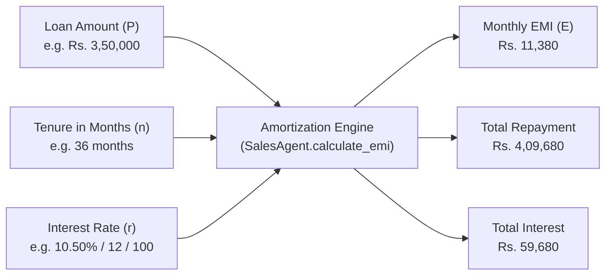

# System Assumptions, Business Rules & Synthetic Data Model

## 1. Executive Summary

This document specifies the financial logic, credit underwriting criteria, regulatory compliance rules, and synthetic customer personas powering the **NBFC Agentic Loan Platform** for the EY Techathon 6.0 problem statement.

---

## 2. Core Business Assumptions

1. **Target Market**: Indian salaried and self-employed individuals seeking unsecured personal loans.
2. **Channel Model**: Digital-first conversational onboarding, qualifying leads from digital campaigns and converting them into sanctioned loan applications within minutes.
3. **Product Parameters**:
   - **Loan Range**: Rs. 50,000 to Rs. 15,00,000.
   - **Tenures**: 12, 24, 36, 48, and 60 months.
   - **Interest Rates**:
     - *Prime Customers* (Score $\ge 750$): 10.50% to 11.50% per annum (reducing balance).
     - *Standard Customers* (Score 700 - 749): 12.00% to 14.00% per annum.
   - **Processing Fee**: Waived (0%) for pre-approved customers; 1.5% for walk-in / guest applicants.
   - **Pre-Payment Penalty**: Zero after 6 completed EMIs.

---

## 3. Financial Computation Models

### 3.1 Reducing-Balance Equated Monthly Installment (EMI)
Monthly repayment obligations are calculated strictly according to the industry-standard reducing-balance amortization model:

$$E = P \cdot r \cdot \frac{(1 + r)^n}{(1 + r)^n - 1}$$

Where:
- $E$ = Equated Monthly Installment (EMI)
- $P$ = Principal Loan Amount
- $r$ = Monthly interest rate ($\text{Annual Rate} / 12 / 100$)
- $n$ = Loan tenure in months



---

## 4. Underwriting Decision Matrix

The Underwriting Agent evaluates incoming applications against a 4-rule hierarchical policy engine to ensure risk mitigation and RBI FOIR (Fixed Obligation to Income Ratio) compliance.

```mermaid
flowchart TD
    Start(["Loan Request Initiated"]) --> CheckScore{"Credit Bureau Score\n>= 700?"}
    
    CheckScore -->|No (< 700)| RejectScore["REJECTED: Below Policy Threshold (Rule 1)\nIssue Bureau Improvement Advice"]
    CheckScore -->|Yes (>= 700)| CheckLimit{"Loan Amount <=\nPre-Approved Limit?"}
    
    CheckLimit -->|Yes| InstantApprove["INSTANT APPROVAL (Rule 2)\nTrigger Sanction Letter Agent"]
    CheckLimit -->|No| CheckDouble{"Loan Amount <=\n2x Pre-Approved Limit?"}
    
    CheckDouble -->|Yes| CheckSalaryDoc{"Salary Slip\nUploaded & Validated?"}
    CheckDouble -->|No (> 2x)| RejectCap["REJECTED: Single-Borrower Cap Exceeded (Rule 4)\nOffer Pre-Approved Amount as Counter-Offer"]
    
    CheckSalaryDoc -->|No| RequestDoc["STATUS: NEEDS_DOCUMENTS\nDocument Agent Prompts for Salary Slip"]
    CheckSalaryDoc -->|Yes| CheckFOIR{"EMI <= 50% of\nNet Monthly Salary?"}
    
    CheckFOIR -->|Yes| EnhancedApprove["APPROVED: Enhanced Limit (Rule 3)\nTrigger Sanction Letter Agent"]
    CheckFOIR -->|No (> 50%)| RejectFOIR["REJECTED: FOIR Ceiling Exceeded (Rule 3)\nCounter-offer Longer Tenure or Lower Amount"]
```

### Rule Definitions & Policy Ceilings

| Rule Code | Evaluation Stage | Condition | Outcome | System Action |
| :--- | :--- | :--- | :--- | :--- |
| **RULE-1** | Credit Bureau Validation | Bureau Score $< 700$ | **Rejected** | Issues adverse action notice explaining 700 threshold; suggests re-application in 90 days. |
| **RULE-2** | Fast-Track Sanction | Bureau Score $\ge 700$ AND Amount $\le$ Pre-Approved Limit | **Instant Approval** | No income proof required; triggers Sanction Agent immediately for PDF compilation. |
| **RULE-3** | Income-Enhanced Sanction | Bureau Score $\ge 700$ AND Amount $\le 2\times$ Pre-Approved Limit | **Conditional Approval** | Requires Salary Slip; Document Agent extracts monthly take-home salary. Approves if $\text{EMI} \le 50\%$ net salary. |
| **RULE-4** | Single-Borrower Hard Cap | Amount $> 2\times$ Pre-Approved Limit | **Rejected with Counter-Offer** | Rejects requested sum; offers instant sanction at the $1\times$ pre-approved limit. |

---

## 5. Synthetic Persona Data Matrix

Ten synthetic customer records are pre-seeded in the database and CRM mock service, representing varied credit tiers, employment profiles, and lending scenarios.

| ID | Persona Name | City | Credit Score | Pre-Approved Limit | Monthly Salary | KYC Status | Target Demo Scenario |
| :--- | :--- | :--- | :---: | :---: | :---: | :---: | :--- |
| `cust_001` | **Rahul Sharma** | Mumbai | **782** | Rs. 5,00,000 | Rs. 85,000 | Verified | **Standard Happy Path**: Instant sanction within pre-approved limit. |
| `cust_002` | **Priya Patel** | Bangalore | **820** | Rs. 7,50,000 | Rs. 1,20,000 | Verified | **High Net Worth**: Premium interest rate (10.0%) and instant sanction. |
| `cust_003` | **Amit Kumar** | Delhi | **715** | Rs. 3,00,000 | Rs. 65,000 | Verified | **Income Enhancement**: Requests Rs. 4.5L ($> 1\times$), uploads salary slip. |
| `cust_004` | **Sneha Reddy** | Hyderabad | **750** | Rs. 6,00,000 | Rs. 95,000 | Verified | **Tenure Negotiation**: Evaluates 24 vs 36 vs 48 months EMI impact. |
| `cust_005` | **Vikram Singh** | Pune | **680** | Rs. 4,00,000 | Rs. 75,000 | Verified | **Rule 1 Edge Case**: Rejection due to credit score below 700 threshold. |
| `cust_006` | **Anjali Verma** | Chennai | **730** | Rs. 2,50,000 | Rs. 55,000 | *Pending* | **KYC Onboarding**: Verifies address & Aadhaar details via CRM lookup. |
| `cust_007` | **Rajesh Gupta** | Kolkata | **800** | Rs. 10,00,000 | Rs. 1,50,000 | Verified | **High Value Borrower**: Maximum pre-approved credit ceiling demo. |
| `cust_008` | **Meera Nair** | Kochi | **740** | Rs. 4,50,000 | Rs. 80,000 | Verified | **Counter-Offer Flow**: Requests Rs. 12L ($> 2\times$ limit), receives Rule 4 counter-offer. |
| `cust_009` | **Arjun Malhotra** | Chandigarh | **660** | Rs. 3,50,000 | Rs. 70,000 | Verified | **Sub-Prime Scenario**: Credit score 660 triggers advisory adverse action. |
| `cust_010` | **Divya Iyer** | Ahmedabad | **790** | Rs. 7,00,000 | Rs. 1,10,000 | Verified | **Zero Existing Debt**: Rapid sanction for home renovation purposes. |
| `guest` | **Guest Applicant** | *Walk-in* | *Dynamic* | Rs. 2,00,000 | *Dynamic* | *Unverified* | **Walk-in Flow**: Uploads PAN/Aadhaar to dynamically calculate bureau score. |

---

## 6. Mock Services Architecture

### 6.1 Offer Mart
Simulates an enterprise offer catalog mapped to each existing customer. Evaluates customer risk profiles and serves customized APR pricing (10.0% to 11.5%) with zero processing fees.

### 6.2 CRM KYC Service
Simulates an internal Core Banking System (CBS) lookup:
- Maps email/customer ID to verified residential addresses.
- Auto-populates Aadhaar and PAN references.
- Validates identity during the Master Agent verification phase.

### 6.3 Credit Bureau API (CIBIL / Experian Simulator)
Generates deterministic credit reports based on verified customer identifiers or extracted PAN numbers, returning score, rating tier, and active delinquency flags.
